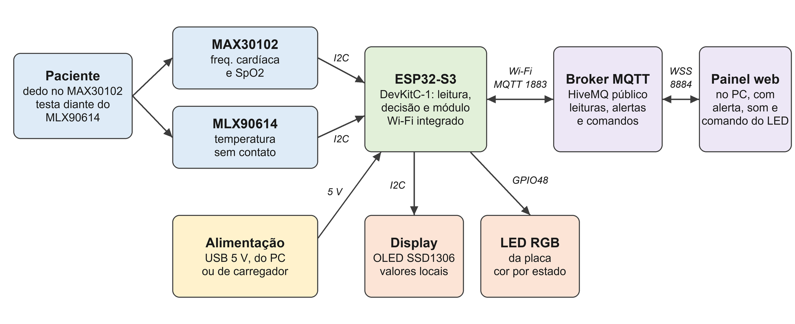
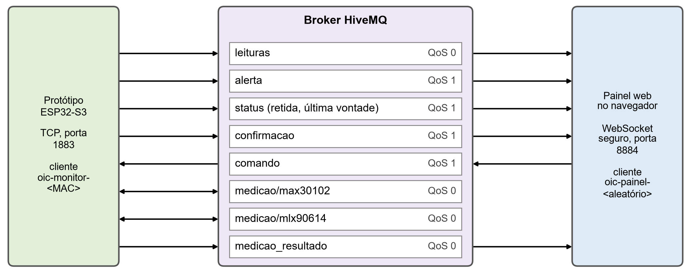

# Monitor de sinais vitais com IoT

Protótipo de baixo custo para o acompanhamento domiciliar de pacientes crônicos, ligado ao Objetivo de Desenvolvimento Sustentável 3, de saúde e bem-estar. Foi desenvolvido na disciplina Objetos Inteligentes Conectados da Universidade Presbiteriana Mackenzie.

Uma placa ESP32-S3 lê a frequência cardíaca e a saturação de oxigênio com o sensor MAX30102 e a temperatura sem contato com o MLX90614. Os valores aparecem em um display OLED e seguem pela internet com o protocolo MQTT até um painel web. O LED RGB da placa é o atuador. Ele muda de cor conforme o estado das leituras e também pode ser comandado pelo painel.

> Este é um protótipo acadêmico e não é um equipamento médico. Ele usa um broker público, sem autenticação, e por isso não deve receber dados reais de pacientes.



## O que o protótipo faz

- Mede a frequência cardíaca (autocorrelação do sinal infravermelho) e a saturação (algoritmo da Maxim).
- Mede a temperatura da testa sem contato e aplica uma correção calibrada contra um termômetro clínico.
- Classifica cada sinal em normal, aviso ou alarme com faixas do NEWS2.
- Acende o LED em verde, amarelo ou vermelho piscando e mostra os valores no display, mesmo sem internet.
- Publica leituras, alertas e estado da conexão por MQTT.
- Recebe comandos do painel para acionar o LED e para medir os tempos de resposta.
- Mostra no painel as leituras, o aviso na tela e o alarme sonoro.

## Estrutura do repositório

| Pasta ou arquivo | Conteúdo |
|---|---|
| `firmware/monitor_sinais_vitais/` | Código da placa, em C++ para a plataforma Arduino |
| `firmware/monitor_sinais_vitais/segredos.h.exemplo` | Modelo do arquivo com o nome e a senha do Wi-Fi |
| `painel/` | Painel web em HTML e JavaScript, com a biblioteca MQTT.js 5.10.1 |
| `dados/` | Medições reais: tempos de resposta, leituras do painel, registro da calibração e terminal serial |
| `docs/hardware.md` | Componentes, ligações, esquema e modelo de montagem |
| `docs/software.md` | Documentação do firmware e do painel |
| `docs/protocolos_e_interfaces.md` | Módulo de comunicação, tópicos, formato das mensagens e interfaces |
| `docs/medicoes.md` | Método e resultados das medições |

## Como usar

### 1. Montar o hardware

Faça as ligações da tabela abaixo, sem protoboard, com um jumper fêmea-fêmea por pino. O detalhe está em [docs/hardware.md](docs/hardware.md).

| Módulo | Alimentação | GND | SDA | SCL ou SCK |
|---|---|---|---|---|
| MAX30102 | 3V3 | GND | GPIO8 | GPIO9 |
| GY-906 (MLX90614) | 5V | GND | GPIO4 | GPIO5 |
| Display OLED SSD1306 | 3V3 | GND | GPIO15 | GPIO16 |

### 2. Preparar o ambiente

1. Instale a Arduino IDE 2 e o pacote `esp32` da Espressif (usada a versão 3.3.12).
2. Em Library Manager, instale `SparkFun MAX3010x` (1.1.2), `Adafruit MLX90614` (2.1.7), `U8g2` (2.36.19) e `MQTT` de Joël Gähwiler (2.5.3).
3. Escolha a placa `ESP32S3 Dev Module`.

### 3. Configurar o Wi-Fi

Copie `segredos.h.exemplo` para `segredos.h`, na mesma pasta, e preencha o nome e a senha de uma rede de 2,4 GHz. O arquivo `segredos.h` está no `.gitignore` e não deve ser enviado ao repositório.

### 4. Gravar o firmware

Abra `firmware/monitor_sinais_vitais/monitor_sinais_vitais.ino`, selecione a porta da placa e clique em Upload. O monitor serial trabalha em 115200 baud. Com o cabo na porta do conversor CP2102, deixe `USB CDC On Boot` em `Disabled`.

Na inicialização, o monitor serial mostra o estado dos sensores, o IP da rede e o identificador do cliente MQTT. O canto superior direito do display mostra `MQTT` quando a placa está conectada ao broker.

### 5. Calibrar a temperatura

Com a testa a 1 ou 2 cm do GY-906, meça a temperatura com um termômetro clínico e digite no monitor serial, com final de linha Newline:

```
t 36.5
```

Depois de 5 pares aceitos, a correção é gravada na memória flash. Os outros comandos são `status`, `apagar` e `correcao <valor>`.

### 6. Abrir o painel

```bash
cd painel
python -m http.server 8123 --bind 127.0.0.1
```

Abra `http://127.0.0.1:8123/index.html` e clique em **Iniciar monitoramento**. O clique é necessário porque o navegador só libera o som depois de uma ação do usuário.

### 7. Medir

Coloque o dedo sobre o MAX30102 e fique parado. A saturação aparece depois de cerca de 5 segundos e a frequência cardíaca depois de cerca de 12 segundos. O botão **Medir atuador e sensores** faz as 4 medições de tempo de resposta de cada item, e **Baixar CSV** salva o resultado.

## MQTT em resumo

Broker público `broker.hivemq.com`, com a placa em TCP na porta 1883 e o painel em WebSocket seguro na porta 8884. Todos os tópicos começam com `mackenzie/oic/monitor-sinais-vitais/`.

| Tópico | Publica | Assina | QoS | Função |
|---|---|---|---|---|
| `leituras` | placa | painel | 0 | Leituras a cada ciclo de cerca de 1 s |
| `alerta` | placa | painel | 1 | Estado e classe de cada sinal, a cada mudança de estado |
| `status` | placa | painel | 1 | `online` ou `offline`, mensagem retida e de última vontade |
| `comando` | painel | placa | 1 | `id;acao`, para o LED e para iniciar a medição |
| `confirmacao` | placa | painel | 1 | Confirma o comando recebido e executado |
| `medicao/max30102`, `medicao/mlx90614` | placa | placa | 0 | Eco usado na medição do tempo de resposta |
| `medicao_resultado` | placa | painel | 0 | Tempo calculado em cada rodada |



## Resultados

Tempos de resposta medidos em 03/11/2026, pela internet, com a rede doméstica e o broker público. Os relógios da placa e do computador não estão sincronizados, então os valores são estimativas pela metade do tempo de ida e volta (ver [docs/medicoes.md](docs/medicoes.md)).

| Medida | Atuador LED RGB (ms) | Sensor MAX30102 (ms) | Sensor MLX90614 (ms) |
|---|---|---|---|
| 1 | 418,65 | 346,60 | 346,17 |
| 2 | 427,50 | 305,38 | 305,45 |
| 3 | 376,15 | 261,77 | 261,56 |
| 4 | 427,45 | 221,00 | 220,98 |
| Média | 412,44 | 283,69 | 283,54 |

## Limitações conhecidas

- O broker é público e a porta 1883 não usa criptografia.
- A calibração da temperatura usou uma única medição do termômetro e uma única pessoa.
- A saturação usa a curva genérica do fabricante do sensor, sem ajuste para este módulo.
- As comparações feitas não têm valor estatístico nem substituem uma validação clínica.

## Referências principais

- ANALOG DEVICES. MAX30102, datasheet, 2018.
- MELEXIS. MLX90614, datasheet, 2026.
- ESPRESSIF SYSTEMS. ESP32-S3 series datasheet, 2026.
- OASIS. MQTT version 3.1.1, 2014.
- ROYAL COLLEGE OF PHYSICIANS. National Early Warning Score (NEWS) 2, 2017.

## Autoria

Caio Henrique Gomes Paulo, com orientação do Prof. Dr. Wilian França Costa.
