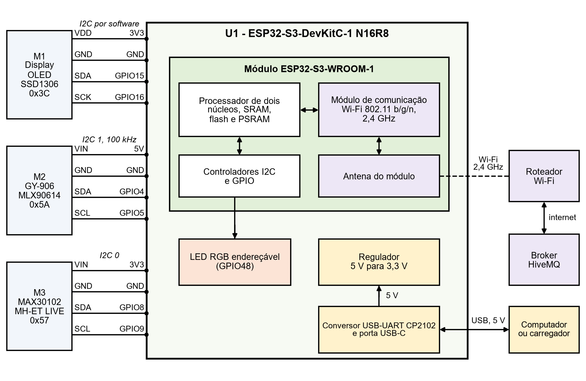
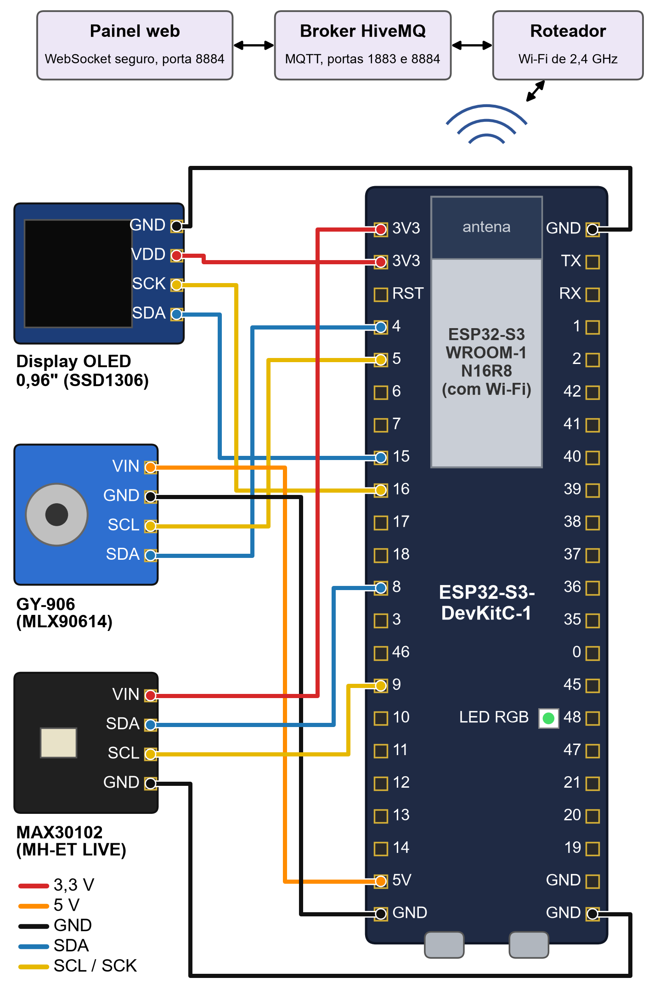

# Hardware

## Componentes

| Componente | Qtd. | Função | Interface |
|---|---|---|---|
| Placa ESP32-S3-DevKitC-1 N16R8, versão compatível com conversor CP2102 | 1 | Processamento, memória, Wi-Fi e LED RGB | USB-C, I2C, GPIO |
| Módulo MAX30102 (MH-ET LIVE) | 1 | Frequência cardíaca e saturação de oxigênio | I2C, endereço 0x57 |
| Módulo GY-906 com o MLX90614ESF-BAA | 1 | Temperatura sem contato | I2C (SMBus), endereço 0x5A, 100 kHz |
| Display OLED de 0,96 polegada com SSD1306 | 1 | Exibição local das leituras | I2C, endereço 0x3C |
| Jumpers fêmea-fêmea | 12 | Ligação de cada pino, sem protoboard | |
| Cabo USB-C | 1 | Alimentação de 5 V e gravação | |

## Atuador

O atuador é o LED RGB endereçável da própria placa, no GPIO48. Em algumas revisões da DevKitC-1 ele fica no GPIO38. O firmware usa a constante `LED`, e a placa usada neste projeto foi confirmada no GPIO48 com um teste de pisca.

| Estado | Cor |
|---|---|
| Sem leitura | Apagado |
| Normal | Verde |
| Aviso | Amarelo |
| Alarme | Vermelho piscando a cada 300 ms |
| Comando do painel | A cor pedida, por 5 s |

## Módulo de comunicação

O módulo de comunicação é o Wi-Fi do próprio ESP32-S3, no padrão IEEE 802.11 b/g/n em 2,4 GHz, com a antena do módulo ESP32-S3-WROOM-1. Não há módulo externo, shield, gateway, comunicação serial com o computador nem protocolo Firmata na comunicação com a internet. A porta USB só alimenta a placa, grava o firmware e fornece o monitor serial.

## Ligações

| Módulo | Pino do módulo | Pino da placa | Barramento |
|---|---|---|---|
| MAX30102 | VIN | 3V3 | |
| | GND | GND | |
| | SDA | GPIO8 | I2C 0 (`Wire`) |
| | SCL | GPIO9 | I2C 0 (`Wire`) |
| GY-906 | VIN | 5V | |
| | GND | GND | |
| | SDA | GPIO4 | I2C 1 (`Wire1`, 100 kHz) |
| | SCL | GPIO5 | I2C 1 (`Wire1`, 100 kHz) |
| Display OLED | VDD | 3V3 | |
| | GND | GND | |
| | SDA | GPIO15 | I2C por software (U8g2) |
| | SCK | GPIO16 | I2C por software (U8g2) |
| LED RGB | integrado | GPIO48 | Sinal digital endereçável |

Nas placas com PSRAM octal, os pinos GPIO35, GPIO36 e GPIO37 são reservados e não podem ser usados. Como a placa é uma versão compatível, a ligação segue o nome impresso ao lado de cada pino, e não a posição.

## Esquema eletrônico

## Modelo de montagem

## Conferência

Um programa de varredura do barramento I2C encontrou os endereços 0x57, 0x5A e 0x3C. Na inicialização do firmware, o monitor serial também informa se o MAX30102 e o GY-906 responderam. Se o MAX30102 falhar ou parar de entregar amostras por 3 segundos, o firmware tenta iniciá-lo de novo.
