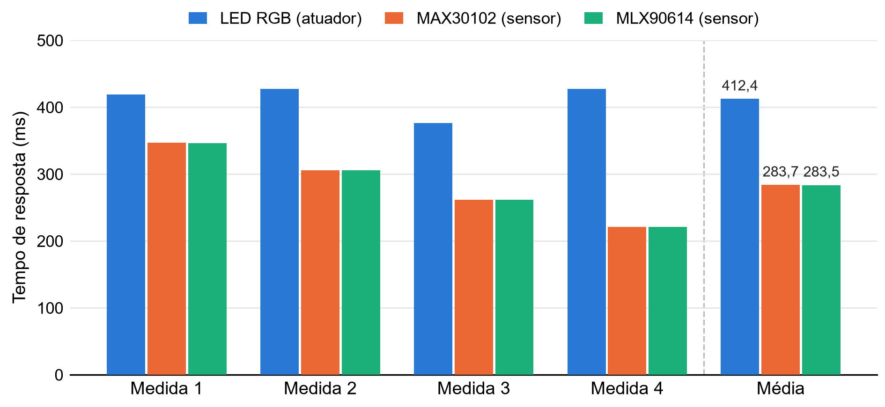

# Medições

Todos os arquivos estão na pasta [`dados/`](../dados).

## Tempos de resposta

Arquivo `tempos_resposta_2026-11-03.csv`. Medição feita pelo botão **Medir atuador e sensores** do painel, com o dedo no sensor, em uma rede Wi-Fi doméstica e com o broker público.

A placa e o computador não têm relógios sincronizados, então o tempo de um único sentido não pode ser medido diretamente. Por isso:

- **Atuador.** O painel publica um comando e mede o tempo até receber a confirmação da placa. O tempo de resposta é metade dessa ida e volta.
- **Sensores.** A placa assina o próprio tópico de medição. O tempo de resposta é o intervalo entre a leitura do sensor e o envio, somado à metade da ida e volta da mensagem até o broker.

Os valores são estimativas, porque a ida e a volta podem não demorar o mesmo tempo. As 4 medições de cada item são poucas para uma análise estatística.

| Medida | Atuador LED RGB (ms) | Sensor MAX30102 (ms) | Sensor MLX90614 (ms) |
|---|---|---|---|
| 1 | 418,65 | 346,60 | 346,17 |
| 2 | 427,50 | 305,38 | 305,45 |
| 3 | 376,15 | 261,77 | 261,56 |
| 4 | 427,45 | 221,00 | 220,98 |
| Média | 412,44 | 283,69 | 283,54 |

Os dois sensores deram tempos quase iguais porque as duas mensagens seguem juntas pelo mesmo caminho até o broker, que domina o tempo total.

## Calibração da temperatura

Arquivo `calibracao_2026-11-03_2128.txt`, com o registro serial completo. Foi feita uma medição com o termômetro clínico, de 36,50 °C, e 5 leituras do GY-906 foram comparadas com esse único valor.

| Par | Termômetro (°C) | GY-906 (°C) | Diferença (°C) | Ambiente no sensor (°C) |
|---|---|---|---|---|
| 1 | 36,50 | 34,47 | 2,03 | 29,5 |
| 2 | 36,50 | 34,59 | 1,91 | 29,8 |
| 3 | 36,50 | 34,61 | 1,89 | 30,4 |
| 4 | 36,50 | 34,43 | 2,07 | 31,5 |
| 5 | 36,50 | 34,71 | 1,79 | 31,2 |

A correção gravada é de 1,94 °C. O desvio padrão de 0,11 °C mostra só a variação do sensor, já que a referência foi uma só.

## Leituras recebidas no painel

Arquivo `leituras_painel_2026-11-03.csv`, com as últimas 60 leituras de frequência cardíaca e saturação recebidas pelo painel, com o dedo no sensor. A frequência ficou entre 71 e 78 BPM. A saturação ficou em 99% em 56 leituras, com um trecho curto de 90% em 3 leituras e 98% em 1 leitura.

Como referência, a saturação na pulseira Mi Smart Band 6 estava em 99%. Foi uma comparação única, com um aparelho de consumo, e a frequência cardíaca não foi comparada nessa ocasião.
