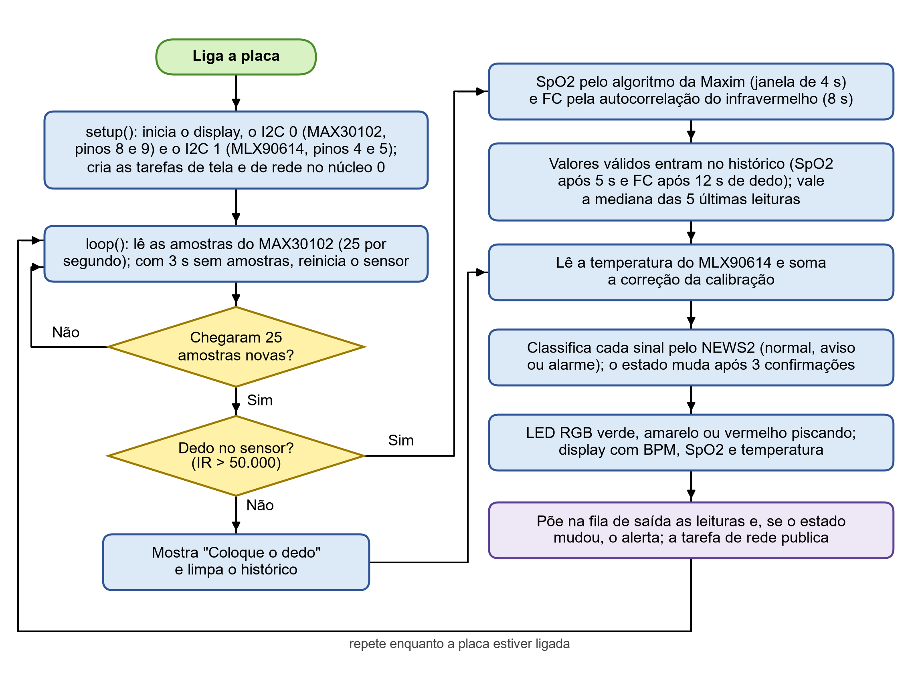
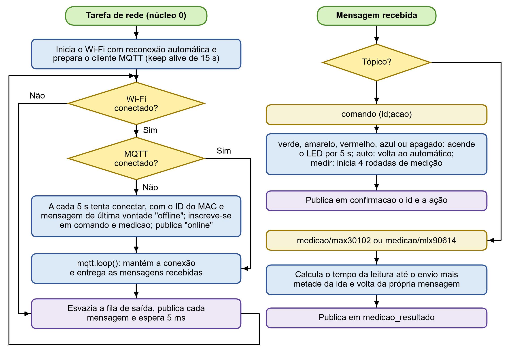

# Software

## Firmware

Arquivo `firmware/monitor_sinais_vitais/monitor_sinais_vitais.ino`, em C++ para a plataforma Arduino, com o pacote `esp32` 3.3.12.

| Biblioteca | Versão | Uso |
|---|---|---|
| SparkFun MAX3010x | 1.1.2 | Leitura do MAX30102 e algoritmo da Maxim para a saturação |
| Adafruit MLX90614 | 2.1.7 | Leitura do sensor de temperatura |
| U8g2 | 2.36.19 | Display OLED por I2C em software |
| MQTT (Joël Gähwiler) | 2.5.3 | Cliente MQTT |
| Preferences e WiFi | do pacote esp32 | Memória flash e conexão à rede |

### Organização em tarefas

| Tarefa | Núcleo | Função |
|---|---|---|
| `loop()` | 1 | Lê os sensores, calcula, classifica, aciona o LED e põe as mensagens na fila |
| `tarefaTela` | 0 | Atualiza o display a cada 100 ms |
| `tarefaRede` | 0 | Mantém o Wi-Fi e o MQTT, recebe mensagens e publica a fila de saída |

A separação evita que o Wi-Fi ou o display atrasem a leitura. A fila do MAX30102 guarda 32 amostras, ou seja, 1,28 s a 25 amostras por segundo, e o ciclo precisa ser mais curto que isso. A comunicação entre as tarefas usa a fila `filaSaida` do FreeRTOS, o mutex `travaLed` e a seção crítica `muxTela`.

### Funções principais

| Função | Descrição |
|---|---|
| `calculaFc()` | Frequência cardíaca por autocorrelação normalizada em janela de 8 s, de 40 a 180 BPM, com correlação mínima de 0,5 |
| `processa(dedo)` | Ciclo de cerca de 1 s: temperatura, históricos, medianas, classificação, tela e publicação |
| `classifica()` e `avalia()` | Aplicam as faixas do NEWS2 e devolvem o pior estado |
| `atualizaLed()` | Aciona o LED pelo estado, respeitando um comando manual em andamento |
| `publicaLeituras()` | Monta as mensagens de leitura, alerta e medição |
| `enfileira()` | Coloca uma mensagem na fila de saída, sem bloquear |
| `aoReceber()` | Trata as mensagens recebidas nos tópicos de comando e de eco |
| `conectaMqtt()` | Conecta com ID derivado do MAC, define a última vontade e faz as inscrições |
| `tarefaRede()` | Laço da conexão, com nova tentativa ao broker a cada 5 s |
| `trataComando()` e `finalizaCalibracao()` | Comandos do monitor serial e cálculo da correção de temperatura |
| `iniciaMax()` | Reinicia o MAX30102 quando as amostras param por 3 s |

### Constantes de decisão

| Constante | Valor | Significado |
|---|---|---|
| `FC_NORMAL_MIN`, `FC_NORMAL_MAX` | 51, 90 | Frequência cardíaca normal, em BPM |
| `FC_ALARME_MIN`, `FC_ALARME_MAX` | 40, 131 | Alarme se até 40 ou a partir de 131 BPM |
| `SPO2_NORMAL`, `SPO2_ALARME` | 96, 91 | Normal a partir de 96%, alarme até 91% |
| `T_NORMAL_MIN`, `T_NORMAL_MAX` | 36,1, 38,0 | Temperatura normal, em °C |
| `T_ALARME_MIN`, `T_ALARME_MAX` | 35,0, 39,1 | Alarme se até 35,0 ou a partir de 39,1 °C |
| `ESTABILIZACAO`, `ESTABILIZACAO_FC` | 5 s, 12 s | Descarte inicial da saturação e da frequência |
| `CONFIRMACOES` | 3 | Ciclos seguidos para mudar de estado |
| `LED_MANUAL_MS` | 5 s | Duração de um comando manual do LED |
| `LIMITE_SEM_AMOSTRA` | 3 s | Tempo sem amostras até reiniciar o MAX30102 |

### Comandos do monitor serial

| Comando | Efeito |
|---|---|
| `t <valor>` | Registra um par de calibração com a temperatura do termômetro, por exemplo `t 36.5` |
| `correcao <valor>` | Grava uma correção manual |
| `status` | Informa a calibração atual |
| `apagar` | Apaga a calibração e tira a temperatura do alerta |

## Painel web

Arquivo `painel/index.html`, com HTML, CSS e JavaScript sem etapa de compilação, e a biblioteca `painel/mqtt.min.js` (MQTT.js 5.10.1).

| Função | Descrição |
|---|---|
| `iniciar()` | Conecta ao broker por WebSocket seguro e assina os tópicos, depois do clique que libera o som |
| `trataLeituras()` | Atualiza os valores e os gráficos curtos |
| `trataAlerta()` e `aplicaEstado()` | Mudam a cor do estado e mostram o aviso |
| `controlaSom()` e `bipe()` | Tocam o alarme com o recurso de áudio do navegador |
| `enviaComando()` e `trataConfirmacao()` | Publicam um comando e medem a ida e a volta até a confirmação |
| `medir()` e `trataResultadoSensor()` | Executam as 4 rodadas de medição e montam a tabela |
| `baixaCsv()` | Salva a tabela de tempos em CSV |

O painel também pode ser usado em outro computador, pois só precisa alcançar o broker pela internet.
